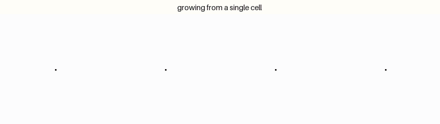
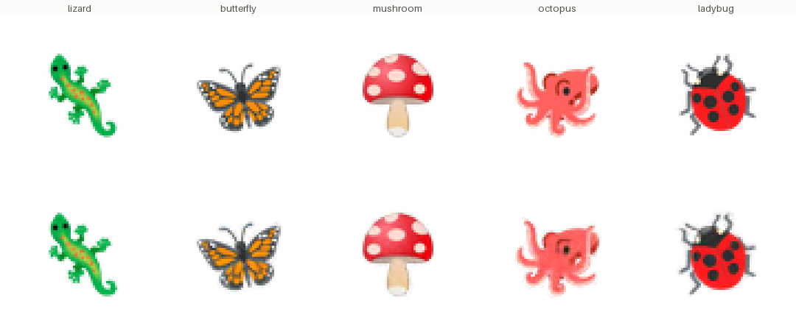
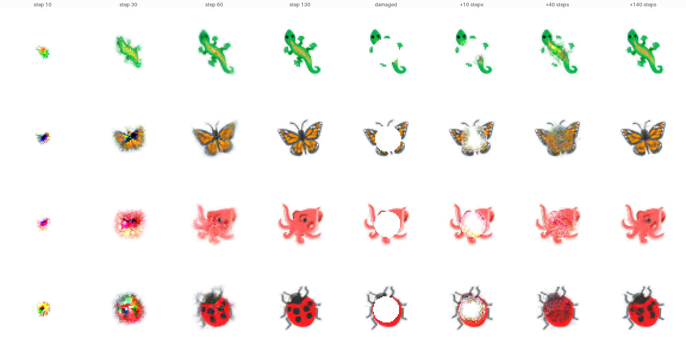
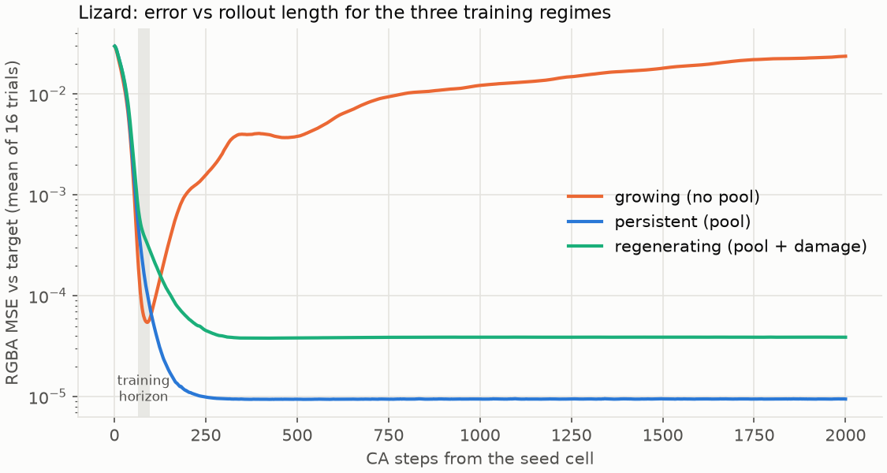
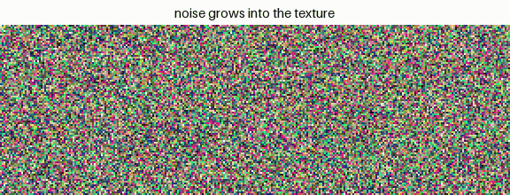
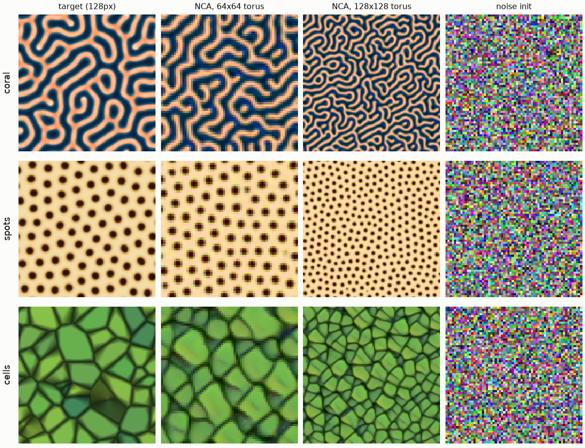

# neural-cellular-automata

Growing Neural Cellular Automata in PyTorch: one tiny per-cell network, applied everywhere, grows an image from a single cell and repairs it after damage. Includes a texture-synthesis extension with a VGG Gram-matrix loss and an interactive in-browser demo.

[](https://github.com/Jai-Advitheeya-Lella/neural-cellular-automata/actions/workflows/tests.yml)



**Live demo:** https://jai-advitheeya-lella.github.io/neural-cellular-automata/ (click and drag to damage a pattern; all models run in your browser).

This is a from-scratch reimplementation written for learning and research, after Mordvintsev, Randazzo, Niklasson and Levin (Distill, 2020) and Niklasson, Mordvintsev, Randazzo and Levin (Distill, 2021). Emoji targets are Noto Emoji (Apache-2.0, see `data/emoji/LICENSE`).

## Highlights

- **The full growing-NCA recipe.** 16-channel cell state, fixed identity + Sobel perception, a per-cell MLP implemented as two 1x1 convolutions with a zero-initialised last layer, stochastic cell updates, alpha-based alive masking, sample-pool training, circular-damage training and per-parameter gradient normalisation.
- **Three training regimes compared on the same target.** Growing-only, pool ("persistent") and pool + damage ("regenerating"), evaluated for 2,000 steps: the pool-trained lizards stay stable beyond the training horizon, and only the damage-trained one repairs itself.
- **Texture synthesis extension.** Toroidal NCAs trained from noise with a VGG-16 Gram-matrix style loss reproduce Gray-Scott reaction-diffusion and Voronoi textures, and the same rule runs on a grid twice the training size.
- **Interactive demo that is checked against PyTorch.** The weights are exported to JSON and run by a dependency-free JavaScript runner (`docs/nca.js`); a test rolls both implementations forward with identical update masks and asserts agreement (worst difference 1.1e-04).
- **Tested.** 36 tests: perception filters, alive masking, fire-rate statistics, translation equivariance on the torus, targets, Gram matrices, a training smoke test and the JavaScript parity check.

## Results

All models were trained on one RTX 5070 Ti that was shared with other jobs, so wall-clock times are upper bounds. Growing models: 8,000 iterations, batch 8, 40x40 targets padded to 72x72, 64-96 steps per iteration, pool of 1,024 states, three damaged samples per batch (regenerating mode), Adam with learning rate 2e-3 (x0.1 after 2,000 iterations); 20 min for the lizard, 8-33 min for the others (the butterfly run was slow because the GPU was shared). Each model has 8,336 parameters.



*Top: targets (40x40 Noto Emoji). Bottom: the pattern each regenerating model grows from a single cell in 200 steps.*

### Damage and regeneration



*Each row: growth from the seed cell, a disc of cells erased, and the recovery.*

### Stability and regeneration, quantitatively

`scripts/evaluate.py` grows each model from the seed with independent stochastic updates (16 trials), measures the RGBA mean-squared error against the target after 96 to 2,000 steps (training used 64-96), then damages the pattern grown for 200 steps and measures the error again after 150 more steps. "Half cut" erases the right half of the grid (never seen in training); "random disc cut" erases a random disc as in training. The last column is the error of an empty canvas, i.e. the cost of having nothing.

| Model (target, training regime) | MSE @96 | MSE @200 | MSE @500 | MSE @1000 | MSE @2000 | MSE after half cut + 150 steps | MSE after random disc cut + 150 steps | empty-canvas MSE |
|---|---|---|---|---|---|---|---|---|
| butterfly, regenerating | 0.00122 | 0.00031 | 0.00026 | 0.00028 | 0.00027 | 0.01432 | 0.00087 | 0.0500 |
| ladybug, regenerating | 0.00126 | 0.00029 | 0.00018 | 0.00017 | 0.00017 | 0.00887 | 0.00166 | 0.0510 |
| lizard, growing | 0.00006 | 0.00106 | 0.00381 | 0.01219 | 0.02375 | 0.01480 | 0.01029 | 0.0300 |
| lizard, persistent | 0.00008 | 0.00001 | 0.00001 | 0.00001 | 0.00001 | 0.00803 | 0.00826 | 0.0300 |
| lizard, regenerating | 0.00029 | 0.00006 | 0.00004 | 0.00004 | 0.00004 | 0.00261 | 0.00016 | 0.0300 |
| mushroom, regenerating | 0.00056 | 0.00023 | 0.00018 | 0.00018 | 0.00018 | 0.01227 | 0.00065 | 0.0824 |
| octopus, regenerating | 0.00143 | 0.00052 | 0.00040 | 0.00042 | 0.00043 | 0.02158 | 0.00147 | 0.0776 |



- **Pool training is what makes the pattern stable.** The growing-only lizard has the lowest error at its training horizon (6e-5 at step 96) but drifts away afterwards, reaching 0.024 at 2,000 steps; both pool-trained lizards stay flat for the whole 2,000 steps.
- **Damage training is what makes it regenerate.** After a random disc cut the regenerating lizard returns to 1.6e-4, the persistent one only to 8.3e-3, and the growing-only one to 1.0e-2.
- **Regeneration is local.** Every model recovers from small discs far better than from a half cut, which is outside the training distribution (errors 2.6e-3 to 2.2e-2 for the regenerating models); I did not try training with larger or stranger damage.
- **Not all emoji are equally easy.** With the default recipe the seed-0 butterfly drifted over long rollouts. Two more seeds were trained and the stablest was used in the demo and the figures above; the seed-0 and seed-1 models are reported here, not hidden:

| butterfly training seed | MSE @200 | MSE @2000 | disc cut + 150 steps | half cut + 150 steps |
|---|---|---|---|---|
| 0 | 0.00154 | 0.02173 | 0.00392 | 0.00766 |
| 1 | 0.00129 | 0.00089 | 0.00171 | 0.02296 |
| 2 | 0.00031 | 0.00027 | 0.00087 | 0.01432 |

Seed 2 was selected because its error at 2,000 steps is lowest. This is selection on the same metric that is reported, so its numbers are optimistic relative to a fresh seed; the other targets used their only (seed 0) run. Evaluation uses 16 trials of stochastic updates with a fixed random seed.

### Texture synthesis (extension)



Three texture NCAs (12 channels, perception = identity + Sobel + Laplacian, circular padding, no alive mask; 5,868 parameters) were trained for 4,000 iterations (7-8 min each) from uniform noise with a sample pool, one fresh noise sample per batch, 32-64 steps per iteration and a loss equal to the relative Gram distance over five VGG-16 ReLU layers plus an overflow penalty. Targets are programmatic: Gray-Scott reaction-diffusion ("coral", "spots") and a periodic Voronoi diagram ("cells").



The style distance is the training loss evaluated on 16 independent runs after 200 steps. For reference, "other samples" are four different random draws of the same procedural texture (different seeds), which shows how far genuine samples of the family are from the single training target:

| Texture | noise init | NCA, 64x64 | NCA, 128x128 (64x64 tiles) | other samples of the texture |
|---|---|---|---|---|
| coral | 0.955 | 0.0511 | 0.0481 | 0.0654 |
| spots | 1.092 | 0.0080 | 0.0090 | 0.0074 |
| cells | 4.514 | 0.0487 | 0.0577 | 0.0830 |

The NCA output is as close to the target's feature statistics as a fresh sample of the texture is (closer for coral and cells, equal for spots), and the 128x128 torus, never seen in training, scores about the same as the training size. The panels are shown at equal size, so the 128x128 output appears at half the feature size of the 64x64 one; in pixels the features are the same size, as expected of a local rule on a torus. The 'target' panel is the 128-pixel source image, whereas the training target was its 64x64 area-downsampled version.

### Browser demo

`docs/index.html` loads `docs/nca.js` and the exported weights in `docs/models/` (408 KB in total). The runner is plain JavaScript on the CPU: 364 steps/s for a 72x72 growing model and 75 steps/s for an 80x80 texture model in Node on this machine (browser speed will vary). To check that it computes the same thing as PyTorch, `scripts/js_reference.py` rolls a model forward 64 steps from a fixed initial state with explicit per-step update masks and `scripts/verify_js.mjs` replays the same masks in JavaScript; `tests/test_js_parity.py` asserts agreement on random and trained models. Maximum absolute difference of the full state:

| model | step 1 | step 30 | step 64 |
|---|---|---|---|
| lizard | 4.5e-08 | 1.2e-06 | 7.2e-07 |
| butterfly | 2.4e-07 | 2.9e-06 | 1.4e-06 |
| texture_coral | 2.7e-07 | 9.2e-06 | 1.1e-04 |
| texture_spots | 2.7e-07 | 1.5e-06 | 5.6e-06 |

(State values are O(1); the differences are float32 rounding.)

## How it works

A grid of cells holds a state vector $x_{ij}\in\mathbb R^{16}$ (RGBA + 12 hidden channels). One step:

1. **Perception.** Each channel is convolved with fixed $3\times3$ filters: identity, Sobel-$x$, Sobel-$y$ (plus a Laplacian for textures), giving a $48$-dimensional perception vector $p_{ij}$ ($16$ channels $\times$ 3 filters; $12\times4$ for textures). Cells can only exchange information through these filters.
2. **Update.** $\Delta x_{ij} = W_2\,\mathrm{ReLU}(W_1 p_{ij} + b_1) + b_2$ with $W_2=0$ at initialisation, so training starts from the identity rule.
3. **Stochastic update.** $x_{ij} \leftarrow x_{ij} + m_{ij}\Delta x_{ij}$ with $m_{ij}\sim\mathrm{Bernoulli}(0.5)$ independently per cell and step; no global clock is needed.
4. **Alive masking** (growing model). A cell is alive if any cell in its $3\times3$ neighbourhood has $\alpha>0.1$ before and after the update; dead cells are set to zero. This makes empty space inert and forces growth to proceed outward from the seed.

**Training the growing model.** The loss is the mean squared error between the RGBA channels after $T\in[64,96]$ steps and the (premultiplied-alpha) target; gradients are back-propagated through all steps (with checkpointing to save memory) and each parameter tensor's gradient is normalised to unit norm before the Adam step. A *sample pool* of 1,024 states is the key to long-term stability: each batch is drawn from the pool, the worst sample is replaced by a fresh seed, and the outputs are written back, so the rule sees (and must keep stable) states from rollouts far longer than $T$. *Regeneration* additionally erases random discs from the three lowest-loss samples of each batch before the rollout.

**Texture NCA.** State starts from noise, the loss is $\frac1L\sum_l \lVert G_l(x)-G_l(t)\rVert_F^2/\lVert G_l(t)\rVert_F^2$ over VGG-16 `relu1_1 ... relu5_1` features (Gram matrices $G_l=F_lF_l^\top/(HW)$), plus the mean excess of any channel outside $[-1,1]$.

## Quickstart

```bash
uv venv --python 3.12 .venv && source .venv/bin/activate
uv pip install torch torchvision --index-url https://download.pytorch.org/whl/cu128   # or the cpu index
uv pip install -r requirements.txt && uv pip install -e .

pytest -q                                                     # needs `node` for the JavaScript parity tests

python -m nca.train --target lizard --mode regenerating       # growing / persistent / regenerating
python -m nca.train_texture --texture coral                   # downloads VGG-16 weights on first use
bash scripts/train_all.sh && bash scripts/train_textures.sh   # every model in this README

python -m nca.export                                          # weights -> docs/models/*.json
python scripts/evaluate.py && python scripts/evaluate_textures.py
python scripts/make_gifs.py --device cuda                     # GIFs and figures in assets/
python -m http.server -d docs 8000                            # then open http://localhost:8000
```

## Project structure

```
src/nca/
  model.py          perception filters, alive mask, NCA module, seed and RGB helpers
  pool.py           sample pool and circular damage masks
  targets.py        Noto Emoji loading (premultiplied alpha) and procedural textures
  train.py          growing / persistent / regenerating training
  style.py          VGG-16 Gram-matrix style loss
  train_texture.py  texture-synthesis training
  export.py         weights <-> JSON (base64 float32) for the browser runner
docs/               GitHub Pages demo: index.html, nca.js, models/
scripts/            evaluation, GIF/figure generation, JS reference + verification, training drivers
tests/              unit tests, training smoke test, JavaScript parity test
data/emoji/         Noto Emoji PNGs (Apache-2.0)
```

## Limitations

- Single training run per model (seed 0), except the butterfly (three seeds, one selected as described above); no confidence intervals on the metrics, which are means over 16 stochastic rollouts.
- The browser runner is CPU-only JavaScript, not WebGL; the 72x72 grids it runs are small enough for that.
- The demo's *perception rotation* slider rotates the Sobel filters as in the 2020 article; I did not implement the isotropic (rotation-equivariant) NCA of Mordvintsev et al. (2022) and did not measure how well rotation works.
- Texture models match feature statistics, not specific images, and were trained on a single 64x64 downsampled target each.
- Only five emoji were trained (`cactus` and `fish` targets are included in `data/` but unused here).

## References

- A. Mordvintsev, E. Randazzo, E. Niklasson, M. Levin. [Growing Neural Cellular Automata](https://distill.pub/2020/growing-ca/), Distill, 2020.
- E. Niklasson, A. Mordvintsev, E. Randazzo, M. Levin. [Self-Organising Textures](https://distill.pub/selforg/2021/textures/), Distill, 2021.
- L. A. Gatys, A. S. Ecker, M. Bethge. [Texture Synthesis Using Convolutional Neural Networks](https://arxiv.org/abs/1505.07376), NeurIPS 2015.
- K. Simonyan, A. Zisserman. [Very Deep Convolutional Networks for Large-Scale Image Recognition](https://arxiv.org/abs/1409.1556), ICLR 2015 (VGG-16 features).
- A. Mordvintsev, E. Niklasson, E. Randazzo. [Growing Isotropic Neural Cellular Automata](https://arxiv.org/abs/2205.01681), 2022 (not implemented here; cited for context).
- [Noto Emoji](https://github.com/googlefonts/noto-emoji), Google, Apache-2.0.

## License

MIT for the code, see `LICENSE`. The emoji images in `data/emoji/` are Apache-2.0 (Noto Emoji).
